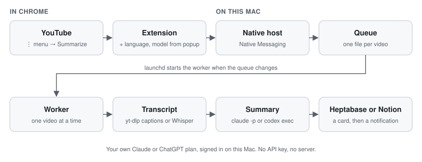

Another framework. Another “must-watch” talk. Another video saved for later.
Keeping up with technology can start to feel like a watch list you will never finish.

yt-digest summarizes a YouTube video for you, on your Mac, with the Claude or ChatGPT plan you already pay for, and
files the summary in Heptabase or Notion. Read it in a minute, then decide whether the full video is worth your time.

## From YouTube to Heptabase

Open a video's ⋮ menu on YouTube, on a card or under the player, and choose **Summarize**. You do not have to open
the video. A few seconds to a few minutes later, a macOS notification says the **digest** is ready; click it to open
the digest, a card in Heptabase tagged `yt-digest` or a page in Notion, with the video embedded at the top and three
sections:

- **Conclusion:** what the video says, in two to four sentences.
- **Main arguments:** about one per three minutes of video, in the speaker's own terms, each linked to its moment.
- **References:** what the video cites, such as articles, repositories and books, each as a link.

The toolbar button picks where the digest is saved (Heptabase, or Notion, in your Private section or inside a folder
page), the digest's language (English by default, or 繁體中文, 简体中文, 日本語, 한국어,
Español) and the model: Claude's, through Claude Code, or OpenAI's, through Codex CLI. The details are in
[`docs/spec.md`](docs/spec.md).

## How it runs



- **Local:** the extension, a Native Messaging host and a launchd worker, all on your Mac. There is no server.
- **Your own plan:** the worker runs `claude -p` or `codex exec`, signed in with your subscription. No API key.
- **Isolated:** a transcript is someone else's text and may try to instruct the model, so the model runs with
  nothing it can act with: no web, no shell, none of your settings, an empty folder, and nothing it writes is run.
- **Private:** what you watch stays on your Mac. The extension keeps only your language and model.
- **Once per video:** a video already summarized is skipped, and a failed one can be requested again.

This is a personal tool, not a service.

## Installing

On a Mac with Apple Silicon, with [Homebrew](https://brew.sh), Chrome and the Heptabase app:

```bash
git clone https://github.com/cjumeow/watch-less.git yt-digest
cd yt-digest
sh scripts/setup.sh
```

The script installs what yt-digest needs and is missing, after asking you once, then installs yt-digest itself:

- Node.js 24, `yt-dlp` (reads a video's subtitles), and `ffmpeg` and `mlx_whisper` (transcribe a video without
  subtitles), with Homebrew and `uv`;
- Claude Code or Codex CLI, whichever you choose, and signs you in with your Claude or ChatGPT plan, not an API key;
- yt-digest, in `~/Library/Application Support/yt-digest/app/`, where Chrome can reach it and it runs in the
  background whenever you request a summary.

Two steps are yours, and the script tells you when:

1. **Heptabase's CLI:** in the Heptabase app's settings, install the CLI and turn on the Local CLI Server.
2. **Notion, optional:** to save digests to Notion, install its CLI with `curl -fsSL https://ntn.dev | bash` and
   sign in with `ntn login`; the script offers the sign-in once `ntn` is installed. Then choose Notion in the popup.
3. **The extension, once:** in `chrome://extensions`, turn on Developer mode, press Load unpacked and pick
   `~/Library/Application Support/yt-digest/app/extension/dist` (press ⌘⇧G in the picker to type the path).

To update, `git pull`, run `npm run install-local`, and press Reload on yt-digest in `chrome://extensions`.

## Development

How the repository is organized, its conventions and the skills agents use are in [`AGENTS.md`](AGENTS.md).

```bash
npm install
npm run check   # everything CI runs
```
